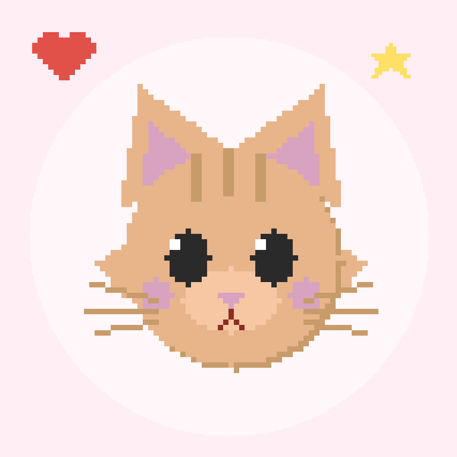

# dsh-pixel-art

给 **没有生图能力的模型**（只能出文本）一支「可编辑的像素画笔」。

模型不写 prompt，而是写**结构化的形状 / 字符网格**；插件在本地零依赖渲染成 PNG，并同时存进画板画廊——人和模型都能接着改。



> 上图为 64×64 模板 `cathead` 放大 3 倍后的效果，全部由代码渲染，没有任何生图模型参与。

## 为什么

DeepSeek 这类纯文本模型不能出图。常见做法是接生图 API，但那要钱、要网络、要模型。

这个插件换了一条路：把「画什么」交给模型（文本），把「怎么变成图」交给本地代码（确定性渲染）。输出不是一张死图，而是**可继续编辑的网格数据**——这一点是扩散模型给不了的。

## 安装

1. 把本目录放进 DSH profile 的插件目录（或按 DSH 的 `install_bundle` 流程安装）。
2. 在 `cordis.patch.yml` 里加一行：

```yaml
- insert:
    - id: dsh-pixel-art
      name: dsh-pixel-art
```

3. 重载宿主，左侧栏会出现「像素画板」。

> 如果 profile 里已有同名插件，先把 `package.json` 的 `name` 改掉再装，避免冲突。

## 工具

### `draw_pixel_scene`

`width/height (1–1024)`、`scale`、`background`、`palette`、`ops[]`。

op：

- `fill` 铺满
- `rect` 矩形（`fill:false` 只画边）
- `line` 直线（`width` 1–16）
- `circle` / `ellipse`（`fill:false` 只画边）
- `polygon` 任意多边形（扫描线填充）
- `dither` 点阵填充（`density` 25/50/75）
- `grid` 小范围字符网格
- `sprite` 内置精灵 / 模板（`name`, `x`, `y`, `scale` 1–8, `flipX`, `tint`）

### `draw_pixel_art`

字符网格 + 调色板逐格上色。空格 = 透明，默认调色板 28 色。

## 画板

- 画布 16–1024 格，缩放（适应 / − / +），大画布滚动查看。
- 画笔 / 橡皮 / 吸管、粗细 1–3、网格线、撤销重做、右键擦除、快捷键、草稿自动恢复。
- 1024 格自动降级：撤销步数按面积收、草稿不存、导出按 8M 输出像素封顶。
- 画廊每 8 秒刷新，点缩略图载回可继续编辑。

## 内置精灵与模板

- 精灵：`cat 16×16`、`house 16×14`、`tree 12×13`、`cloud 14×7`、`sun 11×11`、`heart 12×9`、`star 11×10`、`flower 9×9`、`cake 13×10`、`mushroom 9×9`、`slime 13×9`。
- 模板：`cathead 64×64`，`{shape:'sprite', name:'cathead', scale:3}` 直接用；只用默认调色板字符。

## 能做什么 / 做不好什么

- 稳定：物体、场景、图标、Q 版、模板头像；可编辑、可复现、角色一致性。
- 不足：精细人像、兽设、发丝、写实光影。
- 已试过并否掉：生图模型重画、原图量化、形状硬拼人像。

## 技术说明

架构、接口、渲染细节、已试路线和待解问题见 [SUMMARY.md](SUMMARY.md)。

## 路线

- [x] 1024×1024 画布
- [x] 模板化头像（`cathead`）
- [ ] 表情变体 / 女孩脸模板
- [ ] bezier 曲线 op
- [ ] 可选超采样（`smooth`）

## License

MIT
